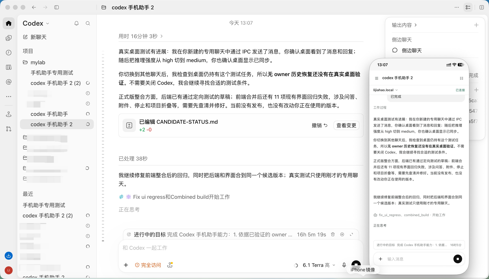
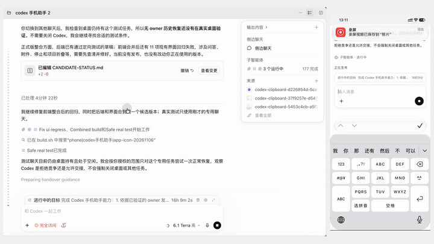

# Codex 手机助手

在手机浏览器查看和操作电脑上的 Codex 任务。先在电脑安装助手并配对手机，手机H5页面即可查看聊天、发送消息和跟进任务进度。

本项目不是 OpenAI 官方产品，部分桌面同步能力依赖可能变化的 Codex 本地接口。

## 使用效果

[观看演示视频](docs/assets/phone-send-demo.mp4)

## 下载与安装

- [下载页面](https://codex.air-inc.top/download/)：选择 GitHub 或百度网盘下载。
- [GitHub 发行版](https://github.com/lijiahao66666/codex-phone-assistant/releases)：查看安装包和版本说明。
- [macOS 安装与使用](macos/README.md)：Apple Silicon，macOS 12 或更新版本。
- [Windows 安装与使用](windows/README.md)：Windows 10/11 x64。

当前版本为 1.0.2。macOS 安装包已提供；Windows 安装包将在同一发行版补充，现有 Windows 用户可继续使用 1.0.1。

安装并登录 Codex Desktop 后，在电脑上打开手机助手并生成配对码；在手机浏览器打开 [codex.air-inc.top](https://codex.air-inc.top/) 输入配对码，或扫描二维码完成配对。

## 功能

查看和切换任务、搜索聊天、查看活动列表、发送消息、停止任务、处理问答与支持的审批，选择模型和推理强度。支持查看文件变更及任务活动。添加到手机主屏幕后，可在授权通知后接收任务完成、待回答和待审批提醒；前台使用时只在任务栏提醒。

H5 自动选择与桌面助手匹配的页面：1.0.0 和 1.0.1 共用旧版页面，1.0.2 使用新版页面。手机和电脑各自维护未读状态。助手发现新版时会提示前往下载页，由用户自行下载安装。

手机新建聊天时，助手先在 Codex Desktop 打开该聊天。确认桌面接管后才发送首条消息。这会切换桌面当前显示的聊天，手机无需退出页面。

历史聊天在连接期间先显示最近内容。需要恢复时，助手打开对应的桌面聊天并确认实时状态；手机切走不会释放桌面 owner。恢复也可能切换桌面当前显示的聊天。

## 已知限制

- 部分聊天冷连接较慢，长会话切换时间会波动。
- 手机与电脑的未读状态不相互同步；归档等任务管理操作仍需在电脑端完成。
- 目标修改、插件和执行环境选择等能力尚未接入；部分历史图片无法预览。
- Mac 安装包未经过 Apple 公证，Windows 安装器没有商业代码签名证书，首次安装可能出现系统提示。

功能边界和开发说明见[文档索引](docs/README.md)。
