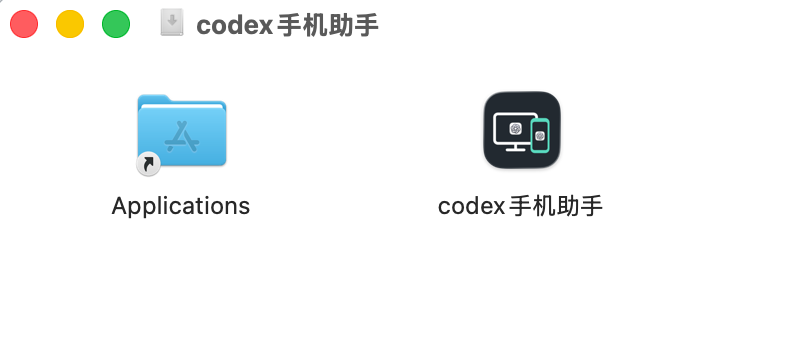
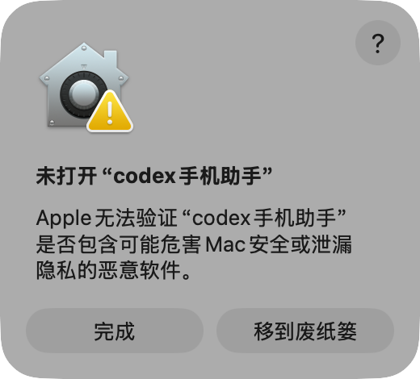
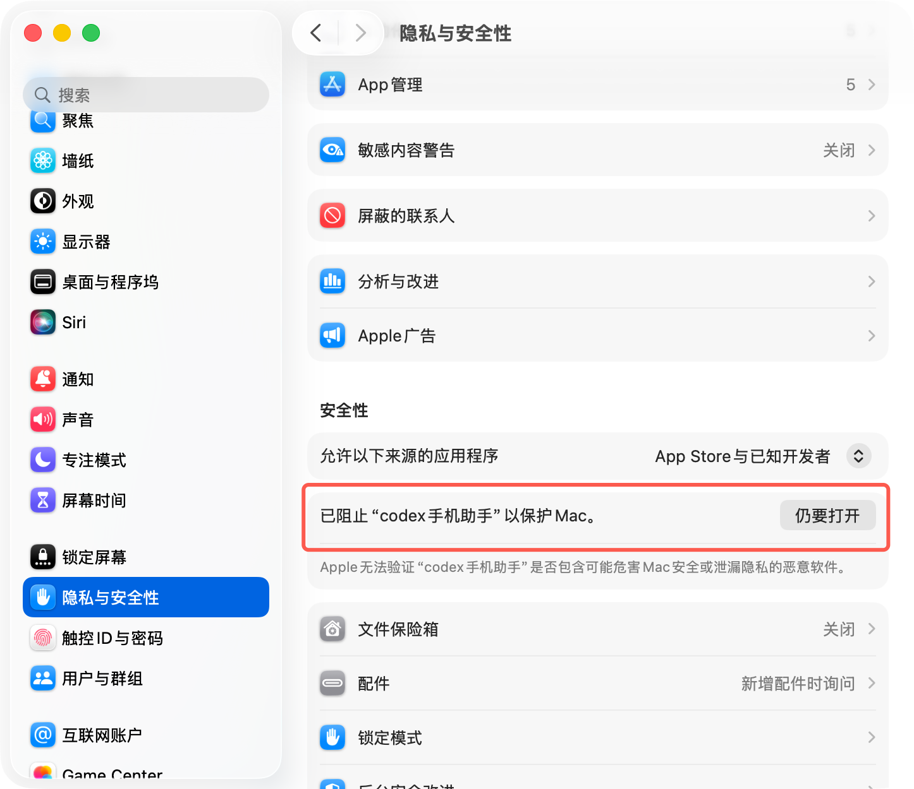
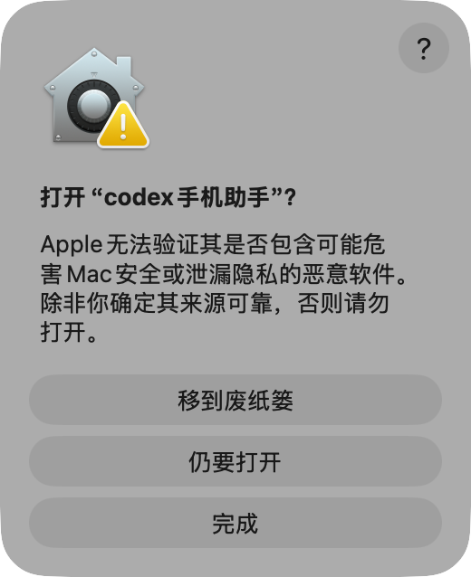
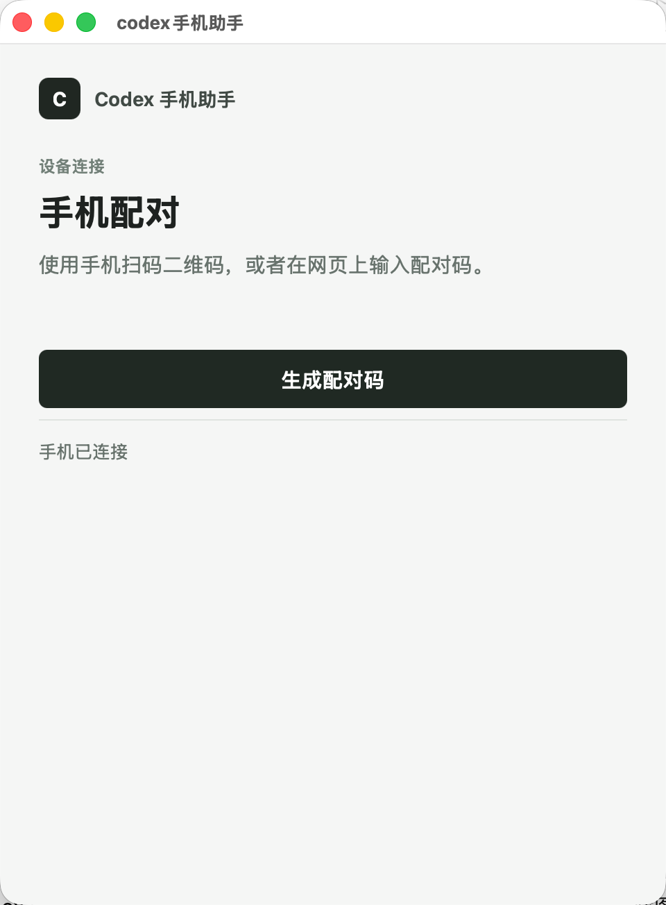

# macOS 安装与使用

macOS 客户端使用 Swift、WKWebView 和菜单栏入口，随包 Node 后台通过本地 IPC 连接 Codex Desktop。当前安装包适用于 Apple 芯片，要求 macOS 12 或更新版本。

[返回项目首页](../README.md) · [手机端能力说明](../docs/CODEX-CAPABILITIES.md)

## 下载

从 [GitHub Releases](https://github.com/lijiahao66666/codex-phone-assistant/releases/tag/v0.1.1) 下载：

- [macOS Apple Silicon DMG](https://github.com/lijiahao66666/codex-phone-assistant/releases/download/v0.1.1/codex-phone-assistant-macos-arm64.dmg)
- [SHA-256 校验值](https://github.com/lijiahao66666/codex-phone-assistant/releases/download/v0.1.1/SHA256SUMS.txt)

也可以从[项目下载页](https://codex.air-inc.top/download/)获取同一安装包。

## 系统要求

- Apple 芯片 Mac（arm64）
- macOS 12 或更新版本
- 电脑上已安装并登录 Codex Desktop

Intel Mac 当前未提供安装包。

> 安装包尚未经过 Apple 公证。只有在确认来源可信、SHA-256 正确时才继续打开；无法验证来源时应停止安装。

## 安装与首次打开

### 1. 移到“应用程序”

打开下载的 DMG，将 `codex手机助手` 拖到 `Applications` 文件夹。



### 2. 从应用程序中启动

打开“应用程序”文件夹并启动 `codex手机助手`。如果 macOS 显示“未打开”，点击“完成”。



### 3. 在隐私与安全性中允许打开

打开“系统设置” → “隐私与安全性”，向下找到被阻止的 `codex手机助手`，点击“仍要打开”。



### 4. 再次确认

在系统提示中再次点击“仍要打开”，并按系统要求完成验证。



完成后会显示本机配对窗口：



## 首次配对

1. 确认 Mac 上的 Codex Desktop 已登录。
2. 打开 `codex手机助手`，点击“生成配对码”。
3. 在手机浏览器打开 <https://codex.air-inc.top/>，输入配对码并在 Mac 客户端确认；也可以扫描电脑上的二维码。
4. 配对成功后，在手机端打开左上角任务面板并选择任务。

## 手机端限制

手机端是电脑版 Codex 的伴生界面。当前开发分支已接入项目选择、新聊天、无 owner 历史恢复、模型和推理强度；这些能力尚未完成公网与 iPhone 验收，既有 Release 不包含本轮改动。新建项目、目标操作、插件、Apps、MCP、Git 分支、worktree 和执行环境尚未接入。目标信息目前只能查看。既有发布版本对照见 [手机端与 Codex 能力对照](../docs/CODEX-CAPABILITIES.md)。

## 托盘与退出

- 关闭窗口会隐藏到菜单栏，后台服务和手机连接继续运行。
- 从菜单栏图标选择“打开 codex手机助手”可恢复窗口。
- 从菜单栏选择“退出 codex手机助手”会在任务空闲时结束窗口和随包 Node 进程；任务运行中或写入结果未知时会保留进程并提示。

## 卸载

1. 从菜单栏退出 `codex手机助手`。
2. 打开“应用程序”文件夹，将 `codex手机助手` 移到废纸篓。
3. 如需彻底清理，请先在应用内移除设备配对，再清理 `~/.config/codex-hub`。

## 从源码构建

要求 macOS、Xcode 命令行工具、Node.js 22 和网络连接。

```sh
npm ci
npm test
npm run build:macos
```

默认输出为 `build/codex手机助手.app`。构建会执行本地 ad-hoc 签名和校验，不包含 Apple Developer ID 签名或公证。

## 故障排查

- **点击打开后没有反应**：确认安装包来自 GitHub Release 或项目下载页，并核对 SHA-256。
- **被 macOS 阻止**：按上面的“隐私与安全性”步骤操作；不要在无法确认来源时绕过系统保护。
- **一直显示“电脑未连接”**：确认 Codex Desktop 已登录且手机助手后台仍在运行。
- **图片或文件按钮未出现**：检查桌面端媒体能力开关和所访问文件的权限范围。

## 验证状态

当前仓库在 Windows 真机完成了完整 H5 联调。macOS 安装说明来自项目下载页，构建脚本已适配新目录结构，但 macOS 安装、配对、消息和停止仍需要在真实 Mac 上复验。
