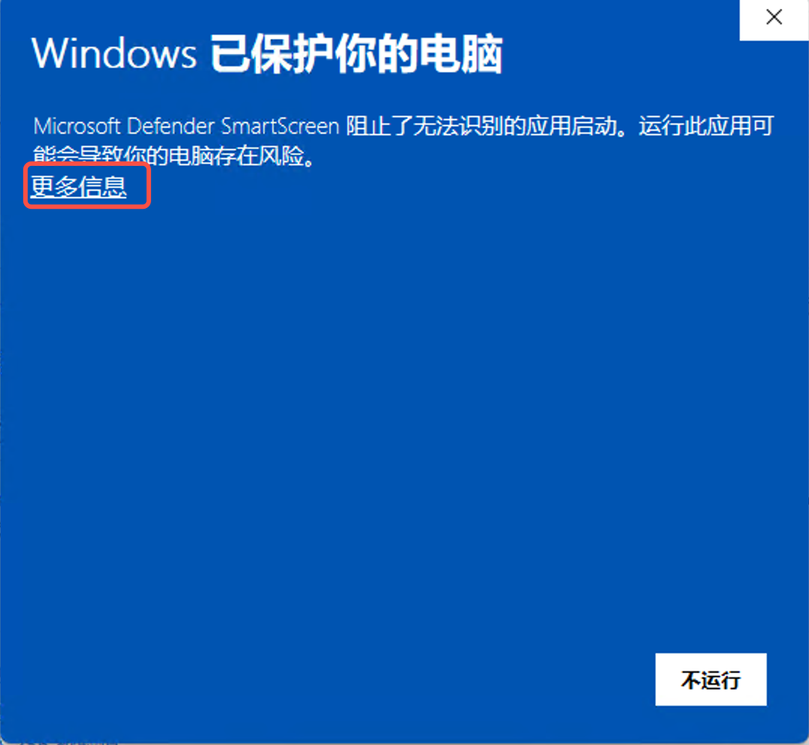
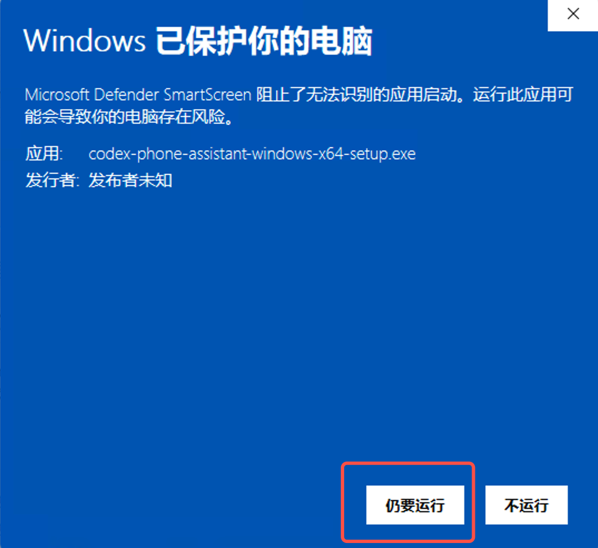
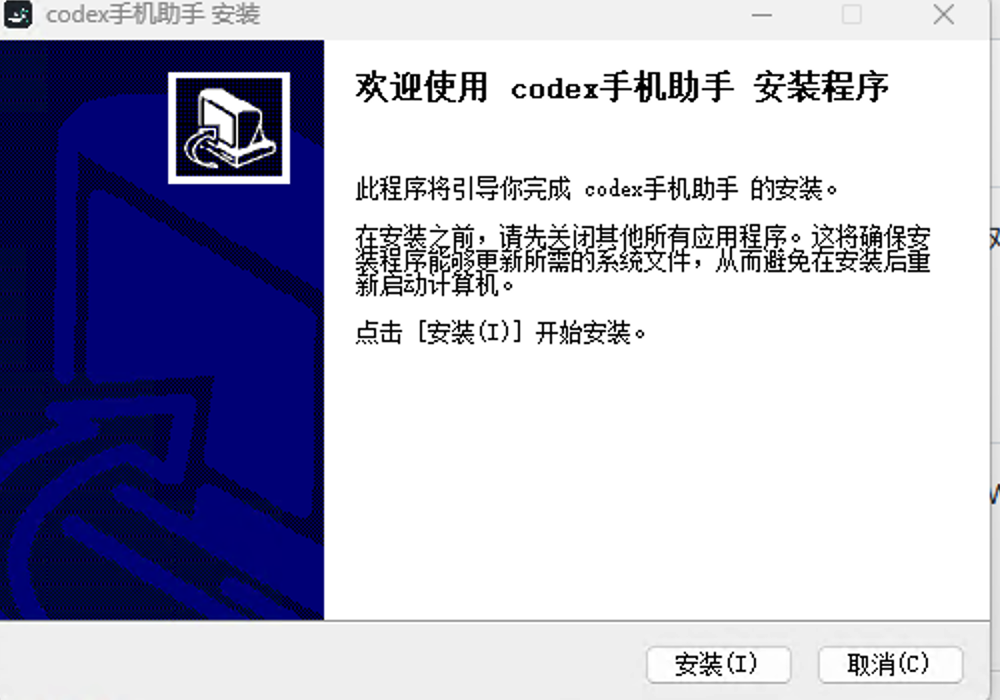

# Windows 安装与使用

[返回项目首页](../README.md) · [手机端能力说明](../docs/CODEX-CAPABILITIES.md)

## 下载

从[项目下载页](https://codex.air-inc.top/download/)或 [GitHub 发行版](https://github.com/lijiahao66666/codex-phone-assistant/releases)获取 Windows 安装包。

## 系统要求

- Windows 10 或 Windows 11，x64
- Microsoft Edge WebView2 Runtime
- 已安装并登录 Codex Desktop

安装包包含 Node.js 和 .NET 运行时，无需另行安装。

## 安装与首次打开

### 1. 运行安装包

打开从项目下载页或 GitHub 发行版获取的安装程序。安装器未使用 Authenticode 证书签名，Windows 可能显示“Windows 已保护你的电脑”。确认文件来源可信后，点击“更多信息”。



### 2. 确认运行

确认显示的程序是下载的手机助手安装包后，选择“仍要运行”。来源不明时不要继续。



### 3. 安装并启动

点击“安装”。默认安装位置为 `%LOCALAPPDATA%\Programs\codex-phone-assistant`，无需管理员权限。安装完成页默认勾选启动助手；也可以稍后从开始菜单启动。



## 首次配对

1. 确认 Windows 上的 Codex Desktop 已登录。
2. 打开手机助手，点击“生成配对码”。
3. 在手机浏览器打开 <https://codex.air-inc.top/>，输入配对码并在电脑上确认；也可以扫描二维码。
4. 配对成功后，在手机端打开任务面板并选择任务。


## 检查更新

右键点击系统托盘里的助手图标，选择“检查更新…”。自动检查默认开启，也可以在托盘菜单关闭。发现新版本时，助手提示打开下载页，由用户选择下载并手动安装；不会自动下载或安装。

版本检查依赖已部署且签名有效的版本信息。首次使用此功能需要手动安装支持它的版本。构建与发布流程见 [Windows 更新说明](windows-updates.md)。

## 托盘与退出

- 关闭窗口会隐藏到系统托盘，后台服务和手机连接继续运行。
- 双击托盘图标或选择“打开 codex手机助手”可恢复窗口。
- 右键托盘图标并选择“退出”结束助手。安装新版本时，安装器会请求当前助手退出；无法退出时会停止安装。

## 卸载

先从托盘退出助手，再在 Windows“设置 → 应用”中卸载 `codex手机助手`，或运行安装目录中的 `卸载.exe`。配对凭据位于 `%USERPROFILE%\.config\codex-hub`；彻底清理前应先在应用内移除设备配对。

## 从源码构建

需要 Node.js 22.17+、.NET 8 SDK 和 NSIS。发布构建需要匹配的更新签名私钥，详见 [Windows 更新说明](windows-updates.md)。

```powershell
npm ci
npm test
npm run build:windows
```

## 常见问题

- **电脑未连接**：确认 Codex Desktop 已登录，且手机助手仍在运行。
- **安装文件被 SmartScreen 拦截**：确认安装包来自项目下载页或 GitHub 发行版，再按上述步骤操作。
- **检查更新失败**：检查网络；如提示签名无效，请勿使用该更新信息。
- **图片或文件按钮未出现**：Windows 媒体能力默认关闭，文字消息和停止任务不受影响。

功能边界见 [手机端与 Codex 能力对照](../docs/CODEX-CAPABILITIES.md)。
