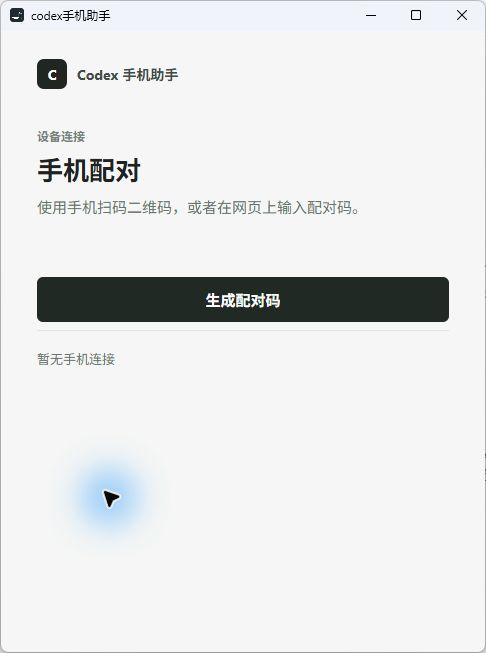

# Windows 安装与使用

Windows 客户端是 WinForms + WebView2 宿主，负责启动随包 Node 后台、显示本机配对面板，并通过本地命名管道连接 Codex Desktop。

[返回项目首页](../README.md) · [手机端能力说明](../docs/CODEX-CAPABILITIES.md) · [Windows 自动更新](windows-updates.md)

## 当前版本

当前 Windows 构建为 `0.3.49`（stable48，构建号 49）。这是首个包含应用内更新能力的 Windows 版本，首次使用必须手动安装；后续版本会在托盘菜单中提示更新。

## 下载

- [Windows 安装包](https://github.com/lijiahao66666/codex-phone-assistant/releases/download/stable48/codex-phone-assistant-windows-x64-setup.exe)
- [Windows 便携版 ZIP](https://github.com/lijiahao66666/codex-phone-assistant/releases/download/stable48/codex-phone-assistant-windows-x64.zip)
- [SHA-256 校验值](https://github.com/lijiahao66666/codex-phone-assistant/releases/download/stable48/SHA256SUMS-windows.txt)

仓库当前为私有，GitHub 下载需要已授权账号。公网固定更新源 <https://codex.air-inc.top/download/windows/latest.json> 已上线并通过签名与摘要核验。安装包内自带 Node 和 .NET 运行时，当前公网完整下载实测约 279 秒，首次下载会明显慢于后续启动。

## 系统要求

- Windows 10 或 Windows 11，x64
- Microsoft Edge WebView2 Runtime
- 电脑上已安装并登录 Codex Desktop

安装版自带 .NET 和 Node.js 运行时，用户不需要另行安装。

## 安装与首次打开

1. 运行 `codex-phone-assistant-windows-x64-setup.exe`。
2. 安装位置为 `%LOCALAPPDATA%\Programs\codex-phone-assistant`，无需管理员权限。
3. 如果 Windows SmartScreen 提示“Windows 已保护你的电脑”，先确认文件来源和 SHA-256。当前安装器没有 Authenticode 商业证书签名，不要绕过来源不明的警告。
4. 从开始菜单启动 `codex手机助手`。



## 自动更新

托盘菜单提供：

- **检查更新…**：立即读取稳定通道清单。
- **自动检查更新**：默认开启。启动后检查一次，之后每 6 小时检查。

发现新版本后，应用会先显示版本号和版本说明链接，经用户确认才下载。更新清单使用独立 ECDSA P-256 签名，安装包还会校验 SHA-256。下载完成后，更新助手等待当前应用退出，再以静默模式运行 NSIS 安装器并重新启动应用。

更新文件位于 `%LOCALAPPDATA%\codex-phone-assistant\Updates`，失败日志为其中的 `update.log`。便携版可以下载并校验更新，但自动安装只支持 NSIS 安装版。

签名、发布顺序和故障边界见 [Windows 自动更新说明](windows-updates.md)。

## 首次配对

1. 确认 Windows 上的 Codex Desktop 已登录。
2. 打开 `codex手机助手`；如果之前已经配对，窗口会显示“手机已连接”。
3. 点击“生成配对码”。
4. 在手机浏览器打开 <https://codex.air-inc.top/>，输入配对码并在 Windows 客户端确认；也可以扫描电脑上的二维码。
5. 配对成功后，在手机端打开左上角任务面板并选择任务。

## 手机端能力与限制

当前稳定版支持查看已有项目、新建聊天、恢复历史聊天、模型与推理强度选择、`Plan`/`Default` 切换、双向发送、停止任务、问答和已支持的命令/文件审批。

以下能力仍未接入：

- 创建、修改、暂停、恢复或清除目标；目标信息只读
- 查看或选择插件、Apps、MCP 或连接器
- 新建项目或完整管理项目
- 选择 cwd、Git 分支、worktree 或执行环境
- 重命名、归档、删除或移动任务

完整对照见 [手机端与 Codex 能力对照](../docs/CODEX-CAPABILITIES.md)。

## 托盘与退出

- 点击窗口关闭按钮只会隐藏到系统托盘，后台 Node 服务和手机连接继续运行。
- 双击托盘图标，或选择“打开 codex手机助手”，可恢复窗口。
- 再次运行 `codex-phone-assistant.exe` 会唤回已有窗口，不会启动第二个后台进程。
- 选择“退出”会结束窗口和随包 Node 进程。
- 自动更新安装前必须退出当前助手；正在进行的手机消息或附件写入会由现有退出保护阻止。

## 卸载

1. 打开“设置” → “应用” → “已安装的应用”。
2. 找到 `codex手机助手`，选择“卸载”。
3. 也可以运行安装目录中的 `卸载.exe`。

卸载会删除程序目录和卸载项。配对凭据位于 `%USERPROFILE%\.config\codex-hub`；彻底清理前应先在应用内移除设备配对。

## 从源码构建

要求 Node.js 22.17+、.NET 8 SDK；生成 NSIS 安装器还需要 NSIS。

```powershell
npm ci
npm test
npm run build:windows
```

发布构建会读取 [version.json](version.json)，生成并签名 `latest.json`。私钥不进入仓库：

```powershell
$env:CODEX_PHONE_WINDOWS_UPDATE_PRIVATE_KEY = 'C:\secure\codex-phone-windows-update-ecdsa.pk8'
npm run build:windows
```

用于本地调试、不准备发布的构建可追加：

```powershell
powershell -NoProfile -ExecutionPolicy Bypass -File windows/build.ps1 -Force -SkipUpdateSigning
```

输出位于 `build/windows/`：

- `dist/codex-phone-assistant.exe`
- `codex-phone-assistant-windows-x64.zip`
- `codex-phone-assistant-windows-x64-setup.exe`
- `latest.json`
- `latest.json.sig`
- `SHA256SUMS.txt`

构建过程会运行 C# 更新服务自测和更新助手实装测试，覆盖清单签名、版本门槛、下载校验、SHA-256 拒绝、等待退出、静默安装和重启。

## 故障排查

- **一直显示“电脑未连接”**：确认 `codex-phone-assistant.exe` 正在运行，Codex Desktop 已登录，并检查 `HUB_ORIGIN` 是否为 <https://codex.air-inc.top>。
- **无法通过命名管道连接**：确认 `\\.\pipe\codex-ipc` 存在，并重启 Codex Desktop 与手机助手。
- **检查更新提示签名无效**：不要安装提示中的文件。核对 `latest.json` 和 `latest.json.sig` 是否来自同一次发布。
- **自动更新失败**：查看 `%LOCALAPPDATA%\codex-phone-assistant\Updates\update.log`；安装包会保留，可手动运行。
- **安装文件被 SmartScreen 拦截**：核对 SHA-256 和来源后，才使用“更多信息” → “仍要运行”。
- **图片或文件按钮未出现**：受桌面媒体能力及其平台开关限制；文字消息和停止任务不受影响。

## 验证范围

Windows 11 x64 构建已覆盖高 DPI、命名管道连接、H5 配对、历史、发送、停止、托盘唤回、安装/卸载和更新器组件测试。没有使用第二台真实 Windows 电脑执行公网生产更新，因此首次正式发布后仍需做一次真实的旧版到新版升级验收。
